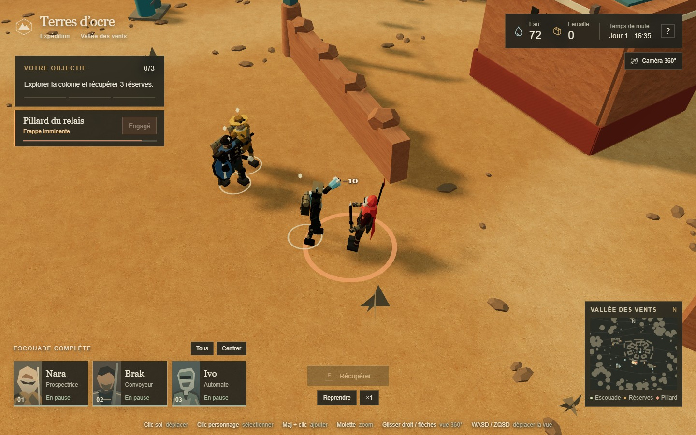

# Terres d’ocre — prototype 3D navigateur

Un jeu d’exploration en escouade dans une vallée désertique, jouable dans le navigateur avec WebGL 2. Nara, Brak et Ivo peuvent explorer le Relais des Toiles, récupérer des réserves et affronter le pillard qui garde la porte sud.

Ce dépôt autonome contient les sources du jeu et ses assets. Les cinq PNG ont été créés pour le projet avec imagegen ; les personnages sont construits et animés par le code. Aucun asset n’a été extrait du jeu Kenshi.

## Démarrer

Sous Windows, lancer **[Lancer-jeu.cmd](Lancer-jeu.cmd)**. Le lanceur démarre un serveur local et ouvre le navigateur à `http://127.0.0.1:4173`. Node.js doit être installé ; le lanceur reconnaît aussi son installation habituelle dans `C:\Program Files\nodejs`, même si Node est absent du PATH.

Depuis un terminal ouvert dans ce dossier, sous Windows, macOS ou Linux avec Node.js installé :

```sh
npm start
```

Ouvrir ensuite `http://127.0.0.1:4173`. Le serveur s’arrête avec Ctrl+C. Sous Windows, le lanceur peut aussi être appelé ainsi :

```powershell
.\start.ps1
```

Le serveur reste actif après fermeture de l’onglet. Pour l’arrêter :

```powershell
.\stop.ps1
```

Pour utiliser un autre port : `powershell -ExecutionPolicy Bypass -File .\start.ps1 -Port 4174`. La progression appartient à l’adresse locale utilisée ; changer de port ouvre un autre espace de sauvegarde dans le navigateur.

Le dossier `dist/` est un site statique complet. Il faut le servir en HTTP ou HTTPS ; l’ouverture directe de son `index.html` depuis le disque ne convient pas aux modules JavaScript et aux textures WebGL.

## Jouer

Le but de l’expédition est de découvrir la colonie et de récupérer trois réserves. L’exploration reste possible après la réussite. Les bidons bleu-vert contiennent de l’eau, les amas de pièces donnent du métal. L’eau diminue pendant le voyage et une réserve vide ralentit l’escouade.

Le combat est facultatif. Choisissez un ou plusieurs voyageurs, puis cliquez sur le pillard au fanion rouge ou sur **Attaquer**. La caméra cadre la rencontre. Lorsque le cercle orange s’élargit aux pieds du pillard, sa frappe se prépare. Un clic au sol ordonne le repli. Le pillard lâche sa cible si elle le distance. Chaque portrait indique la vie du voyageur. À zéro PV, il reste à terre pour cette expédition.



| Commande | Action |
| --- | --- |
| Clic sur le sol | Déplacer les personnages sélectionnés |
| Clic sur une réserve | S’y rendre et la récupérer |
| Clic sur le pillard, T ou « Attaquer » | Engager la sélection au corps à corps |
| Clic personnage ou portrait, touches 1 / 2 / 3 | Sélection individuelle |
| Maj + clic | Ajouter ou retirer un personnage de la sélection |
| G ou « Tous » | Sélectionner les trois personnages |
| F ou « Centrer » | Retrouver la sélection avec la caméra |
| Molette | Zoom |
| Glisser bouton droit | Rotation libre à 360° et inclinaison de la caméra |
| Touches fléchées | Tourner à gauche/droite et régler l’inclinaison |
| « Caméra 360° » | Ouvrir les commandes de rotation, d’inclinaison et de zoom ; maintenir un bouton pour continuer |
| « Suivre » | Suivre le centre des personnages sélectionnés pendant leur déplacement |
| R ou « Vue initiale » | Rétablir l’orientation, le zoom et la cible de départ |
| Bouton central ou glisser tactile | Déplacer la vue |
| WASD / ZQSD | Déplacer la caméra |
| E ou « Récupérer » | Prendre une réserve à proximité |
| Espace ou « Pause » | Arrêter / reprendre la simulation |
| Bouton ×1 / ×2 / ×3 | Vitesse de simulation |
| Échap | Annuler l’ordre en cours, y compris l’attaque |
| Clic sur la minimap | Déplacer le centre de la caméra |

Sur écran tactile : toucher pour donner un ordre, glisser avec un doigt pour déplacer la vue, glisser avec deux doigts pour tourner et incliner, et pincer pour zoomer. Faire pivoter les deux doigts fait aussi tourner la caméra. Les portraits et boutons fournissent la sélection, la récupération, la pause et la vitesse. La minimap est masquée sur les petits écrans.

La caméra tourne sans limite horizontale, avec des transitions progressives. L’inclinaison reste bornée pour éviter les retournements et la vue reste au-dessus du terrain. La rotation et le zoom conservent le suivi ; déplacer manuellement la vue ou cliquer sur la minimap l’interrompt. Les commandes de caméra restent utilisables lorsque la simulation est en pause. « Centrer » adapte le cadrage à la dispersion des personnages sélectionnés et aux proportions de l’écran.

La sauvegarde locale conserve la progression, les ordres, les PV, la phase du combat, la sélection et la caméra. Elle s’effectue environ toutes les huit secondes, à la récolte et lorsqu’un combattant tombe. Une expédition enregistrée avant la version 0.3 reprend avec le pillard à la porte sud. L’aide « ? » contient « Recommencer l’expédition ». Quitter l’onglet met la simulation en pause.

## Contenu

- Quatre silhouettes animées. Nara porte un poncho ocre, Brak un bouclier bleu, Ivo un gantelet turquoise et le pillard un fanion rouge.
- Terrain de 180 × 180 unités, huit bâtiments accessibles, portique caravanier, auvents à motifs tissés, citernes et pompe à vent animée.
- Quatre lieux à découvrir et neuf réserves d’eau ou de métal.
- Navigation A* avec évitement des obstacles et contrôle continu des segments du chemin.
- Caméra tactique, ombres, brume, sélection d’escouade, carte et HUD responsive.
- Sauvegarde, reprise et réinitialisation locales.

## Organisation et dépendances

| Fichier | Rôle |
| --- | --- |
| `dist/js/main.js` | Rendu, caméra, entrées, simulation, collecte et sauvegarde |
| `dist/js/world.js` | Terrain, colonie, lieux, ressources et obstacles |
| `dist/js/characters.js` | Modèles procéduraux et animation articulée |
| `dist/js/combat.js`, `dist/js/encounter.js` | Règles de mêlée, poursuite, animation des coups et sauvegarde de la rencontre |
| `dist/js/navigation.js` | Grille A*, index spatial et collisions de trajet |
| `dist/js/camera.js` | Orbite à 360°, cadrage, suivi et dégagement du terrain |
| `dist/index.html`, `dist/style.css` | Interface et aide |
| `dist/assets/` | Textures et concept issus du kit artistique |
| `dist/vendor/` | Three.js 0.170.0, version locale et licence MIT |
| `server.mjs` | Serveur HTTP local sans dépendance npm |
| `tests/navigation.test.mjs` | Régressions de navigation et accessibilité des lieux |
| `tests/camera.test.mjs` | Rotation, cadrage, suivi, limites et restauration de caméra |
| `tests/combat.test.mjs`, `tests/encounter.test.mjs` | Dégâts, repli, KO, reprise et déplacement des combattants à la porte sud |

Aucune installation npm ni compilation n’est nécessaire. Three.js et les assets sont servis localement, sans appel à un CDN pendant le jeu. Le rendu s’appuie sur les API documentées par le [projet Three.js](https://threejs.org/docs/). La licence de la bibliothèque est conservée dans `dist/vendor/THREE-LICENSE.txt`.

## Vérification

```sh
npm run check
npm test
```

Sept tests de navigation vérifient les approches des neuf ressources depuis les positions initiales, les trajets entre ressources, l’entrée et la sortie des huit bâtiments, les changements d’ordre et deux régressions de collision. Chaque segment est contrôlé indépendamment par échantillonnage de la distance aux obstacles.

Treize tests de caméra vérifient les tours complets, le passage entre deux angles voisins à la limite de ±180°, le cadrage en portrait et paysage, le suivi, le retour à la vue initiale, les données de sauvegarde invalides et le dégagement au-dessus du terrain.

Huit tests couvrent les règles du combat. Deux autres vérifient le combat sur le terrain réel aux trois vitesses et la distance parcourue sur des trajets courts. `npm test` exécute les trente tests.

La [revue navigateur de la caméra](reports/camera-verification.json) couvre plusieurs tours complets au clic droit, les boutons maintenus, les touches fléchées, les gestes à deux doigts, le suivi pendant la marche et la restauration de la vue. Les gestes de caméra n’ont produit aucun ordre de déplacement involontaire pendant ces essais.

Une revue réelle a été effectuée dans Microsoft Edge, avec WebGL 2 via SwiftShader, en vues 1 440 × 900 et 390 × 844. Le démarrage, les quatre textures, le clic au sol, le déplacement, la sélection, la pause, les vitesses, le zoom et la récolte ont été vérifiés. Une expédition complète a atteint l’objectif ; le rechargement a restauré sa progression et « Recommencer » l’a réinitialisée. Ces essais ne constituent pas une mesure de performances sur un téléphone physique. Voir [le compte rendu](reports/verification.json).

Le lanceur et l’arrêt ont également été essayés sur un port distinct, avec réponse HTTP 200.

## Hébergement

Le dossier `dist/` peut être déployé sur un hébergement statique avec HTTPS. Il contient tous les modules, la bibliothèque Three.js et les images nécessaires. Le jeu n’utilise ni API externe ni service de sauvegarde distant.

## Licence

Le code et les assets propres au projet sont fournis sous la [licence MIT](LICENSE) existante du projet source. Three.js conserve sa [licence MIT](dist/vendor/THREE-LICENSE.txt).
